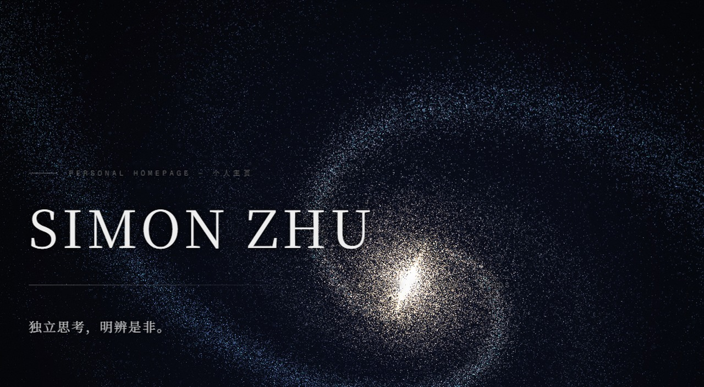

<div align="center">



**个人主页 · 個人主頁 —— 一颗粒子构成的宇宙**

大爆炸 → 星系 → 黑洞吸积盘 → 点阵行星，滚动驱动的 WebGL 粒子形态变换

<br>

[](https://github.com/handsomezhuzhu/my_page/actions/workflows/preview.yml)
[](https://handsomezhuzhu.github.io/my_page/)
[](https://handsomezhuzhu.github.io/my_page/traditional/)

[简体中文](#简体中文) · [繁體中文](#繁體中文)


</div>

---

## 简体中文

### ✦ 概览

一个深色极简风格的个人主页。首屏之外全是同一个粒子系统：**26 万颗粒子在单个 WebGL 顶点着色器里插值运动**，跟着滚动在三种宇宙形态之间坍缩与重组，没有一帧 Canvas 画死的东西。

| 预览 | 地址 |
| --- | --- |
| 简体（zh-CN） | <https://handsomezhuzhu.github.io/my_page/> |
| 繁体（zh-HK） | <https://handsomezhuzhu.github.io/my_page/traditional/> |

### ✦ 粒子宇宙

每个粒子同时持有三份形态坐标（每粒子 16 个 float 交错打包，`w` 分量复用编码类别+亮度），GPU 按滚动进度原地插值——形态切换是**有方向的引力坍缩**，不是随机换位的溶解。

| 形态 | 章节 | 组成 |
| --- | --- | --- |
| 🌌 `G` 星系 | 首屏 | 对数双旋臂 + 暖色核球 + 青色恒星形成区 + 尘埃盘 |
| 🕳️ `D` 吸积盘 | 座右铭 | 事件视界 + 光子环 + 引力透镜光晕 + 多普勒增亮盘 |
| 🪐 `P` 行星 | 链接 | 程序化大陆点阵 + 夜侧城市灯光 + 大气辉边 + 行星环 |

另有：大爆炸闪光开场（冲击波环 + 核心辉光）、点击独立涟漪（连点不打断前一波）、移动端水平滑动倾斜、遵循 `prefers-reduced-motion`。

### ✦ 双分支语言策略

| 分支 | 语言 | 字体 | 页脚备案 | 线上部署 |
| --- | --- | --- | --- | --- |
| `main` | 简体 | Noto Serif SC | 显示 ICP / 公安备案 | 构建后上传 `out` 到自有服务器 |
| `traditional` | 繁体 | Noto Serif TC | 不显示备案 | Cloudflare Pages 推送自动部署 |

两分支除字体、文案、备案外完全一致。共享代码在 `main` 上提交，再 `git checkout traditional && git merge main` 同步。

### ✦ 快速开始

```bash
npm install
npm run dev      # http://localhost:3000
npm run build    # 静态产物 → out/
npx serve out    # 本地预览构建产物
```

### ✦ 构建与 CI

推送 `main` 或 `traditional` 自动触发 [GitHub Actions](.github/workflows/preview.yml)（instabox CI runner）：

| 输出 | 内容 |
| --- | --- |
| Artifact `out` | 简体生产构建（无 basePath，可直接上传服务器） |
| Artifact `out-traditional` | 繁体生产构建 |
| GitHub Pages | 两个预览地址见上方徽章 |

`next.config.mjs` 的 `basePath` 由 `BASEPATH` 环境变量控制，本地开发为空、无感知。

### ✦ 目录结构

```
├── app/                        # 页面（layout / page / globals.css）
├── components/
│   ├── cosmos-field.tsx        # 粒子宇宙调度（开场动画 / 滚动 / 涟漪）
│   ├── home-shell.tsx          # 页面骨架与章节切换
│   └── …（header / hero / motto / links / footer）
├── lib/cosmos/
│   ├── generate.ts             # 三形态粒子数据烘焙（星系 / 吸积盘 / 行星）
│   └── shaders.ts              # GLSL：插值 + 配色 + 后期处理
└── .github/workflows/          # CI：双分支构建 + Pages 预览
```

### ✦ 配置说明

- 备案信息：`lib/config.ts` 的 `showBeian` 开关
- 导航链接：`components/navigation-links.tsx`
- 文案：`components/hero-section.tsx`、`components/motto-section.tsx`

---

## 繁體中文

### ✦ 概覽

一個深色極簡風格的個人主頁。首屏之外全是同一個粒子系統：**26 萬顆粒子在單個 WebGL 頂點著色器裡插值運動**，跟著捲動在三種宇宙形態之間坍縮與重組，沒有一幀 Canvas 畫死的東西。

| 預覽 | 地址 |
| --- | --- |
| 简体（zh-CN） | <https://handsomezhuzhu.github.io/my_page/> |
| 繁體（zh-HK） | <https://handsomezhuzhu.github.io/my_page/traditional/> |

### ✦ 粒子宇宙

每個粒子同時持有三份形態座標（每粒子 16 個 float 交錯打包，`w` 分量複用編碼類別+亮度），GPU 按捲動進度原地插值——形態切換是**有方向的引力坍縮**，不是隨機換位的溶解。

| 形態 | 章節 | 組成 |
| --- | --- | --- |
| 🌌 `G` 星系 | 首屏 | 對數雙旋臂 + 暖色核球 + 青色恒星形成區 + 塵埃盤 |
| 🕳️ `D` 吸積盤 | 座右銘 | 事件視界 + 光子環 + 引力透鏡光暈 + 都卜勒增亮盤 |
| 🪐 `P` 行星 | 連結 | 程序化大陸點陣 + 夜側城市燈光 + 大氣輝邊 + 行星環 |

另有：大爆炸閃光開場（衝擊波環 + 核心輝光）、點擊獨立漣漪（連點不打斷前一波）、行動端水平滑動傾斜、遵循 `prefers-reduced-motion`。

### ✦ 雙分支語言策略

| 分支 | 語言 | 字體 | 頁尾備案 | 線上部署 |
| --- | --- | --- | --- | --- |
| `main` | 簡體 | Noto Serif SC | 顯示 ICP / 公安備案 | 構建後上傳 `out` 到自有伺服器 |
| `traditional` | 繁體 | Noto Serif TC | 不顯示備案 | Cloudflare Pages 推送自動部署 |

兩分支除字體、文案、備案外完全一致。共享程式碼在 `main` 上提交，再 `git checkout traditional && git merge main` 同步。

### ✦ 快速開始

```bash
npm install
npm run dev      # http://localhost:3000
npm run build    # 靜態產物 → out/
npx serve out    # 本地預覽構建產物
```

### ✦ 構建與 CI

推送 `main` 或 `traditional` 自動觸發 [GitHub Actions](.github/workflows/preview.yml)（instabox CI runner）：

| 輸出 | 內容 |
| --- | --- |
| Artifact `out` | 簡體生產構建（無 basePath，可直接上傳伺服器） |
| Artifact `out-traditional` | 繁體生產構建 |
| GitHub Pages | 兩個預覽地址見上方徽章 |

`next.config.mjs` 的 `basePath` 由 `BASEPATH` 環境變數控制，本地開發為空、無感知。

### ✦ 目錄結構

```
├── app/                        # 頁面（layout / page / globals.css）
├── components/
│   ├── cosmos-field.tsx        # 粒子宇宙調度（開場動畫 / 捲動 / 漣漪）
│   ├── home-shell.tsx          # 頁面骨架與章節切換
│   └── …（header / hero / motto / links / footer）
├── lib/cosmos/
│   ├── generate.ts             # 三形態粒子資料烘焙（星系 / 吸積盤 / 行星）
│   └── shaders.ts              # GLSL：插值 + 配色 + 後期處理
└── .github/workflows/          # CI：雙分支構建 + Pages 預覽
```

### ✦ 設定說明

- 備案資訊：`lib/config.ts` 的 `showBeian` 開關
- 導覽連結：`components/navigation-links.tsx`
- 文案：`components/hero-section.tsx`、`components/motto-section.tsx`

---

<div align="center">
  <sub>© 2025–2026 Simon · 粒子宇宙的每一次坍缩都是为了下一次重组</sub>
</div>
